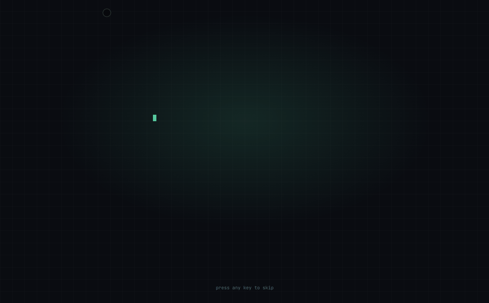

<div align="center">

# `>_` The AI Engineer Playbook

**Get more out of AI coding assistants. Waste less of them.**

An interactive, eight-episode playbook on the habits that make tools like GitHub Copilot actually useful.
Every episode is a short story, a hands-on lab, and a quick quiz.

[**▶ Live demo**](https://harsha-1-8.github.io/ai-engineer-playbook/) ·
[Episodes](#the-episodes) ·
[How it's built](#how-its-built) ·
[Run locally](#run-locally)

<br>
<a href="https://harsha-1-8.github.io/ai-engineer-playbook/">
  
</a>

</div>

---

## Origin story

I led a self-initiated R&D effort at work on getting the **same results from GitHub Copilot while
spending fewer tokens, without lowering output quality**, covering context management, prompt design
and model selection. I published the findings internally as an eight-part series for fellow developers.

This repo is the public, interactive remake: the same lessons, rebuilt so you can *play* with each idea
instead of just reading about it.

## The episodes

Each episode follows two developers, Rohan and Neel, as they tackle the same task two different ways.

| #  | Episode                          | The habit                                              | Lab                                                     |
| -- | -------------------------------- | ------------------------------------------------------ | ------------------------------------------------------- |
| 01 | The Case of the Missing Tokens   | Give the relevant context, not the whole project       | **Context builder:** attach files, watch the token meter |
| 02 | The Conversation That Never Ends | Start a fresh chat when the task changes               | **Fresh-chat decision:** continue or reset, pick what to carry |
| 03 | The Model Mismatch               | Match model capability to task complexity              | **Model router:** send a backlog to light vs reasoning models |
| 04 | The Log Overload                 | Share the signal, not the whole log                    | **Log hunt:** click the lines that matter               |
| 05 | The Output Trap                  | Ask for the right scope, format and depth              | **Prompt shaper:** tune a prompt, watch the response size |
| 06 | Ask or Agent?                    | Ask for understanding, Agent for action                | **Mode picker:** six situations, Ask or Agent           |
| 07 | Trust, But Verify                | Review and test what AI writes                         | **Code review:** flag the bugs in AI-generated code     |
| 08 | The Journey Continues (finale)   | One workflow from all seven habits                     | **Assemble the playbook:** rebuild the workflow from memory |

Progress is saved in your browser. Clear every lab and quiz to light up the finale's constellation and earn the badge.

**Extras:**

- **`Ctrl+K` / `⌘K` command palette.** Fuzzy-jump to any episode or page, switch theme, or continue where you left off.
- **12 achievements**, from *Flawless* (solve a lab on the first try) to one hidden one. Find them on the Journey page.
- **Celebrations:** confetti and toasts when you solve a lab or finish an episode, and a bigger burst for finishing the chapter.
- **Light and dark themes** that follow your OS until you pick one.
- **Smooth page transitions:** episode titles morph from card to page (View Transitions API).
- A terminal-style intro on first visit, and an easter egg for anyone who types the magic word.

## How it's built

| Layer    | Choice                                                                                                  |
| -------- | ------------------------------------------------------------------------------------------------------- |
| Frontend | Angular 21 (standalone, zoneless, signals), TypeScript (strict), SCSS                                   |
| Content  | Typed local data, no backend needed                                                                     |
| Hosting  | GitHub Pages, auto-deployed on every push to `main` via [GitHub Actions](.github/workflows/deploy.yml) |

Design decisions worth a look:

- **Content as a typed discriminated union.** Lessons are lists of `LessonBlock`s (`prose`, `comparison`,
  `scenario`, `takeaway`, `workflow`, …) keyed by `type`. The renderer is a single `@switch` with
  template type narrowing, so adding a block type means adding one interface and one `@case`
  ([`episode.model.ts`](frontend/src/app/content/lessons/episode.model.ts),
  [`lesson-section.html`](frontend/src/app/pages/episode-detail/lesson-section/lesson-section.html)).
- **Signals end to end.** The route `:slug` binds directly to a component `input()` via
  `withComponentInputBinding()`. The page (episode, neighbours, outline, section numbering) is all
  `computed()` from that one input. The app runs zoneless.
- **Progress without a backend.** `ProgressService` holds state in a signal, persists it with an
  `effect()` to `localStorage`, and exposes derived `computed()` values (completed count, next up)
  that the header ring, journey timeline, home CTA and finale badge all react to.
- **Self-contained labs.** Each lab is a standalone component with its own state and a single
  `solved` output. The episode page only records the result.
- **No drift.** The finale recap stores only slugs; episode titles and numbers are resolved at render
  time. The finale lab reads its steps from the authored workflow block.
- **Zero-dependency delight.** Confetti is a small canvas particle system; the palette is a native
  `<dialog>`; page transitions use the browser's View Transitions API. Everything respects
  `prefers-reduced-motion`.
- **Accessible by default.** Skip link, semantic landmarks, `aria-pressed` toggles, `aria-live`
  feedback and visible focus.

```
frontend/src/app
├── content/              # episodes, quizzes and achievements as typed data
├── core/services/        # lessons, progress, achievements, theme, palette, celebrations
├── pages/
│   ├── home/             # landing page, animated hero, terminal intro
│   ├── learning-journey/ # git-log style timeline + trophy shelf
│   └── episode-detail/   # episode page + lesson-section renderer
└── shared/
    ├── components/       # header, footer, command palette, confetti/toasts
    ├── directives/       # count-up stats
    └── labs/             # one component per lab, plus the quiz
```

## Run locally

Prerequisites: **Node.js 24+** and **npm 11+**.

```bash
cd frontend
npm install
npm start        # http://localhost:4200
npm test         # unit tests (Vitest)
npm run build    # production build → frontend/dist
```

---

<sub>Built by [Harshavardhan V S](https://github.com/harsha-1-8). An independent learning project; scenarios and examples are illustrative.</sub>
